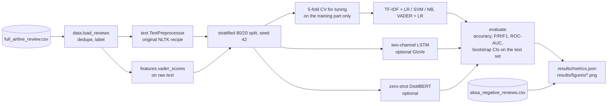
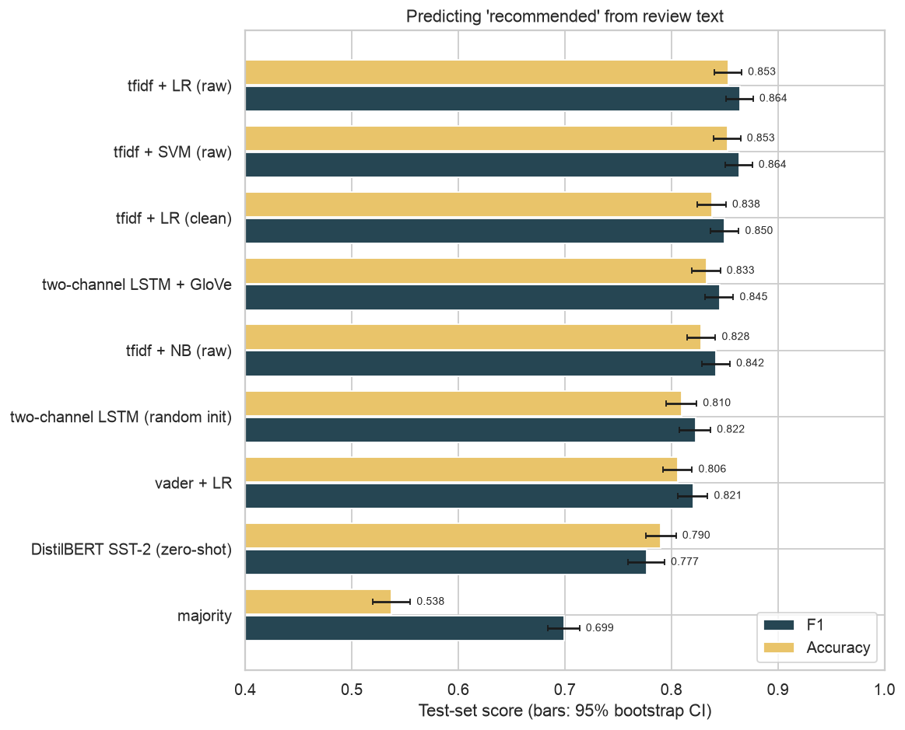
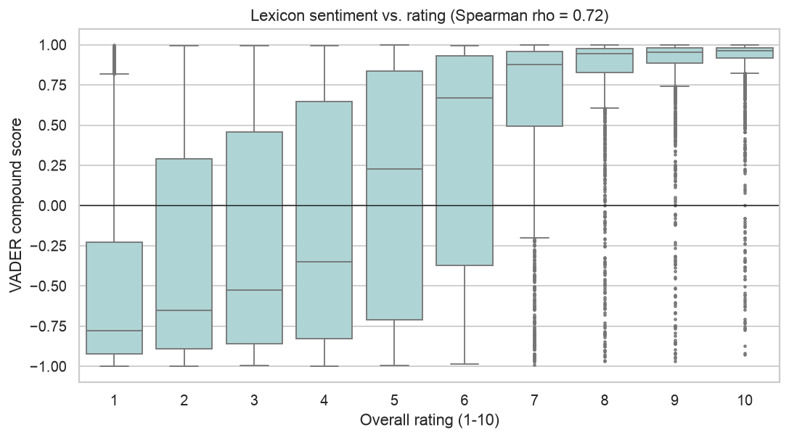
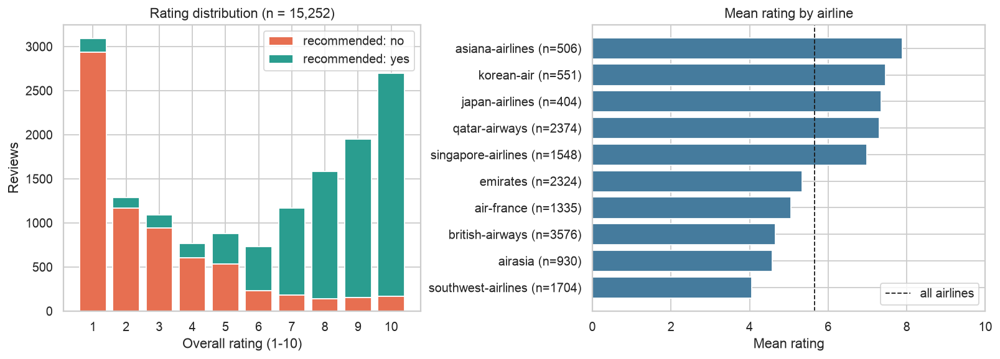
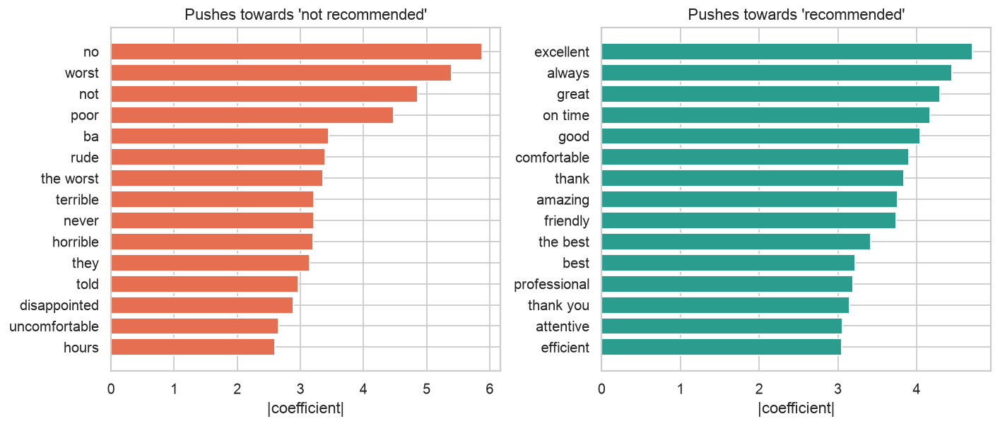
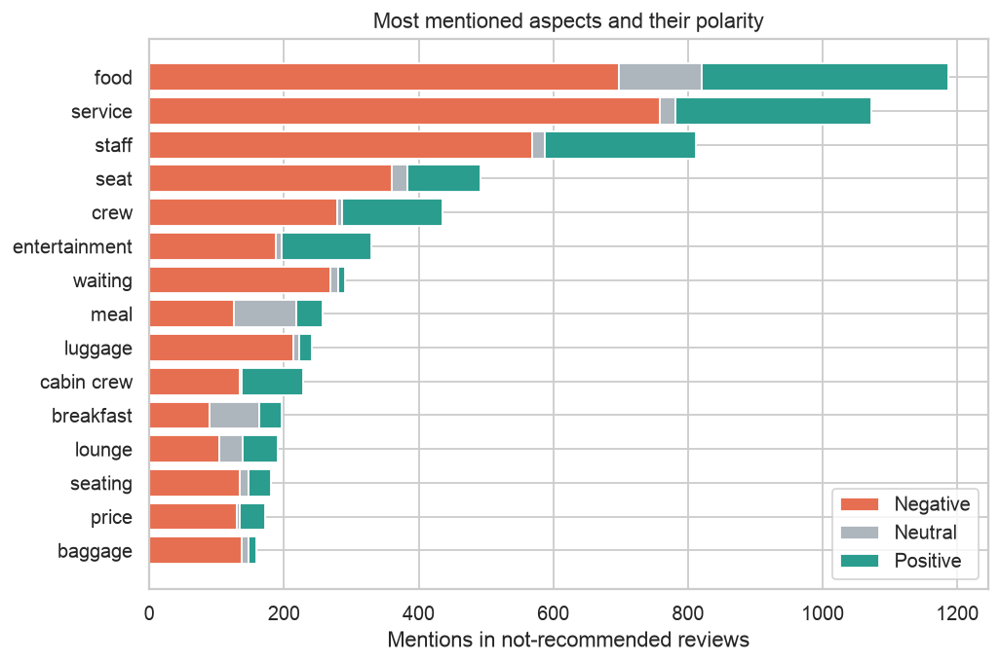
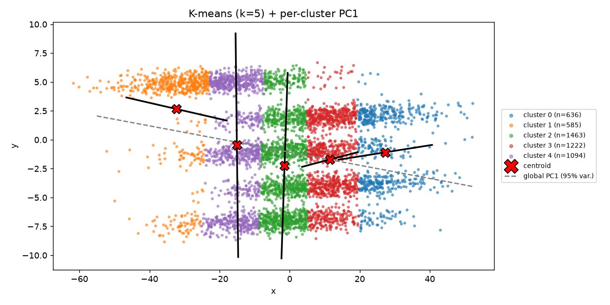
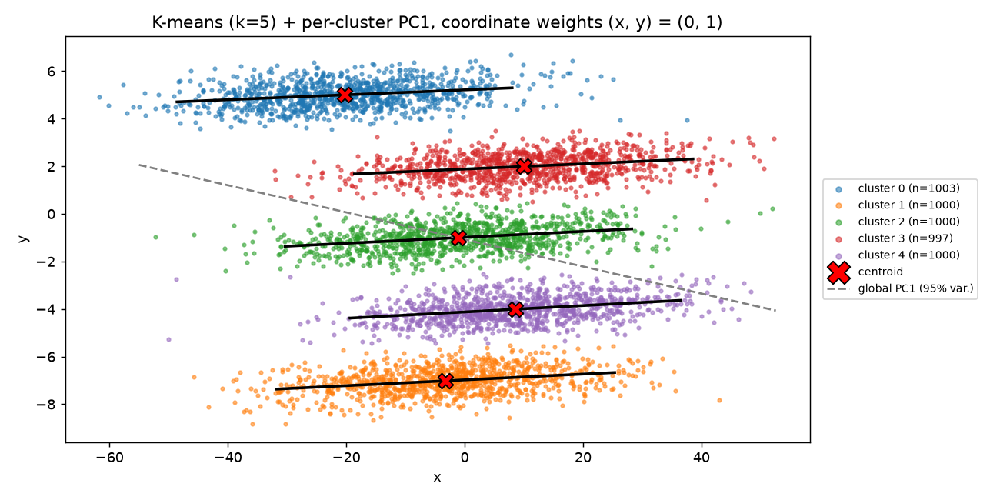
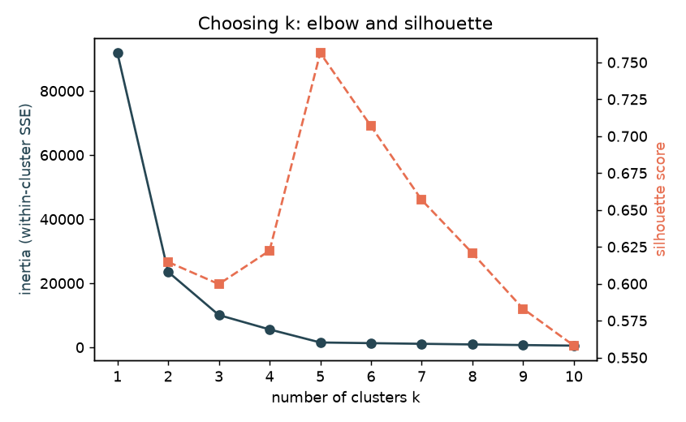
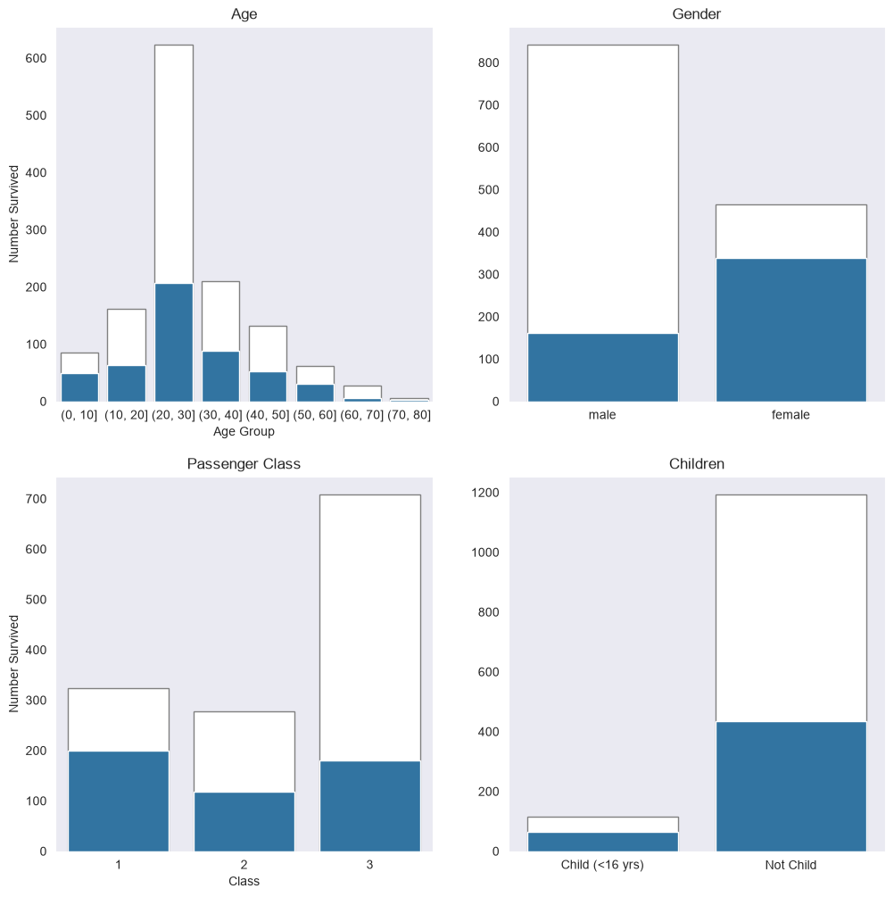

# datamining

[](https://github.com/Ctwqk/datamining/actions/workflows/ci.yml)

Data-mining coursework (2024) rebuilt as a reproducible, tested repository: an airline-review text-mining
pipeline (preprocessing, features, models, evaluation), a PySpark friend recommender, K-means and PCA written
from scratch, and a Titanic visualisation notebook. Everything runs from a clean checkout with `uv`, and every
number in this README was produced by the code in this repository.

| Project | Question | Method | Headline result |
|---|---|---|---|
| [`airline_review_mining`](airline_review_mining) | Can review text predict whether the reviewer recommends the airline, and the 1-10 rating? | NLTK/VADER, TF-IDF + linear models, two-channel LSTM (GloVe), zero-shot DistilBERT | TF-IDF + logistic regression test accuracy **0.853** vs 0.538 majority baseline |
| [`hw3_friend_recommendation`](hw3_friend_recommendation) | Whom should a social network suggest as friends? | MapReduce-style PySpark job (mutual-friend counts) | Spark output identical to a pure-Python reference on all 1,000 users of a synthetic graph; fixed a bug in the original job |
| [`hw4_kmeans_pca`](hw4_kmeans_pca) | What clusters does a 2-D point cloud contain? | K-means and PCA in NumPy | Reproduces the original script exactly; clustering on y alone recovers five groups of about 1,000 points |
| [`hw7_titanic_survival`](hw7_titanic_survival) | Who survived the Titanic? | pandas/seaborn visualisation + logistic regression | 38.2% survived; 96.5% of first-class women vs 15.2% of third-class men |

## Quickstart

Requirements: [uv](https://docs.astral.sh/uv/) and, for the PySpark part, a JDK (17 or 21; tested with 21).

```bash
git clone https://github.com/Ctwqk/datamining.git && cd datamining
uv sync --extra deep --extra spark                  # locked, pinned dependencies (uv.lock)

uv run pytest -q                                    # includes Spark, LSTM and notebook checks; downloads NLTK corpora on first run
uv run airline-reviews run --sample 1500 --no-lstm --out /tmp/airline-smoke    # smoke run, under a minute
uv run python hw4_kmeans_pca/kmeans_pca.py --out /tmp/hw4                      # K-means + PCA figures
uv run python hw3_friend_recommendation/friend_recommendation_spark.py --users 11 924   # PySpark job
uv run python scripts/run_notebooks.py --out-dir /tmp/notebooks                # execute all notebooks
```

The full airline run that produced the committed `airline_review_mining/results/` (about 13 minutes on 4 CPU
threads of a shared workstation, no GPU) is described in
[Reproducing the committed results](#reproducing-the-committed-results).

## Airline-review mining

**Data.** `airline_review_mining/data/full_airline_review.csv`: 15,386 reviews of ten airlines scraped from
[airlinequality.com](https://www.airlinequality.com) (Skytrax) in April 2024 (rating 1-10, header, text,
airline, "recommended" yes/no). After dropping 134 exact duplicates, 15,252 reviews remain; 53.8% are
recommended, the mean rating is 5.65 and the median review has 114 words. `absa_negative_reviews.csv` holds
aspect-level sentiment for the 7,102 not-recommended reviews (the code that produced it is not in this
repository, so it is used as given input).

**Pipeline.**



Linear-model hyperparameters are tuned with cross-validation inside the training split; LSTM early stopping
uses a separate validation subset of that training split. Vectorisers are fitted inside each training fold,
and the LSTM vocabulary uses only its internal training subset. Each model is evaluated on the same 3,051
test reviews after fitting. The confusion matrix and rating-regression plot always show TF-IDF + logistic
regression and TF-IDF + ridge, respectively; test scores do not choose these diagnostic models.

The table is an exploratory comparison across models, not an independent estimate of a model selected by
its test ranking. The notebook also inspects test errors. Choosing a model or changing it in response to these
results would require a fresh holdout or nested cross-validation for an unbiased final estimate.

**Results: predicting "recommended" (test set, n = 3,051, 53.8% positive).**

| Model | Accuracy | F1 | ROC-AUC |
|---|---|---|---|
| TF-IDF + logistic regression (raw text) | **0.853** | **0.864** (95% CI 0.851-0.877) | 0.906 |
| TF-IDF + linear SVM (raw text) | 0.853 | 0.864 | 0.906 |
| TF-IDF + logistic regression (original cleaning) | 0.838 | 0.850 | 0.899 |
| Two-channel LSTM + GloVe 840B | 0.833 | 0.845 | **0.908** |
| TF-IDF + complement Naive Bayes | 0.828 | 0.842 | 0.881 |
| Two-channel LSTM, random embeddings | 0.810 | 0.822 | 0.881 |
| VADER scores + logistic regression | 0.806 | 0.821 | 0.867 |
| DistilBERT SST-2, zero-shot | 0.790 | 0.777 | 0.892 |
| Majority class | 0.538 | 0.699 | 0.500 |



**Results: predicting the 1-10 rating (test set).**

| Model | MAE | RMSE | R2 | Spearman |
|---|---|---|---|---|
| TF-IDF + ridge | **1.334** | 1.712 | 0.752 | 0.847 |
| VADER scores + ridge | 1.690 | 2.160 | 0.604 | 0.764 |
| Training mean | 3.147 | 3.435 | 0.000 | - |

**What the analysis shows** (details and code in [`notebooks/02_analysis.ipynb`](airline_review_mining/notebooks/02_analysis.ipynb)):

- *The original preprocessing hurts.* The coursework recipe keeps only tokens found in the NLTK `words`
  dictionary and removes stop words. On a 500-review sample it keeps 39.4% of the alphabetic tokens: inflected
  forms ("seats", "flights", "delayed") are not in the dictionary and negations ("not", "no") are stop words, so
  "The seats were not comfortable and the flights were delayed." becomes just "comfortable". The same logistic
  regression scores 0.838 accuracy on that text vs 0.853 on the raw text (the 95% bootstrap intervals of F1,
  0.837-0.863 vs 0.851-0.877, overlap slightly, so treat the gap as suggestive rather than conclusive).
- *Lexicon sentiment tracks the rating.* Spearman correlation between the VADER compound score and the rating
  is 0.72; mean compound is 0.70 for recommended and -0.23 for not-recommended reviews.
  
- *The label is noisy.* About 5% of 1-star reviews say "recommended" and about 6% of 10-star reviews say "not
  recommended". The most confident model errors are positive 9-10 star reviews marked "not recommended".
  
- *The bag-of-words model partly learns airline identity.* "ba" (British Airways) is among the strongest
  negative terms, next to "worst", "rude" and "told"; British Airways has a 40% recommendation rate in this
  dataset. Results therefore describe this scraped sample, not airlines in general.
  
- *Complaints are about food, service and staff.* In the 7,102 not-recommended reviews the most mentioned
  aspects are food (1,186 mentions), service (1,072), staff (812), seat (492) and crew (435).
  
- *A general-purpose pretrained model is not automatically better.* The zero-shot DistilBERT (trained on
  movie-review sentiment, never on this data) is precise (0.904) but misses about a third of the recommended
  reviews (recall 0.681) and ends up below TF-IDF + logistic regression. It was not fine-tuned.
- The LSTM (a repair of the original, see design notes) improves from 0.810 to 0.833 accuracy with pretrained
  GloVe vectors (99.8% of its 9,556-word vocabulary covered; one seed each) but does not beat the linear
  baseline on 12k training reviews. Its test ROC-AUC (0.908) is on par with the best linear model (0.906).

## hw3: friend recommendation with PySpark

**Question and method.** For every user, recommend up to 10 people who are not yet friends, ranked by the
number of mutual friends (ties: smaller id first). The PySpark job emits every ordered pair inside each friend
list, drops pairs that are already friends, sums the rest and ranks per user.
`friend_recommendation_spark.py` also contains a pure-Python reference implementation (`--engine python`) used
as the test oracle.

**Data.** The assignment's `friends.txt` was downloaded from the author's Google Drive and is not in the
repository, so `sample_friends.txt` is a synthetic 1,000-user, 6,847-friendship graph generated
reproducibly by `make_sample_graph.py` (ten communities, stochastic block model).

```text
$ uv run python hw3_friend_recommendation/friend_recommendation_spark.py --users 11 924
2 users have at least one recommendation (engine: spark)
11      63,10,14,15,29,30,31,38,43,44
924     931,902,929,946,949,965,999,903,909,912
```

**Verification.** `results/sample_recommendations.tsv` (all 1,000 users) is byte-identical between the Spark and
the Python engines. Tests check the Python reference against an independent brute-force definition on random
graphs, then compare Spark with that reference on the toy and 1,000-user synthetic graphs.

**Bug found in the original job.** `subtractByKey` was applied to an RDD keyed by `user` instead of the
`(user, friend)` pair, so it removed nothing and current friends were recommended. On a four-user toy graph the
original code returned `1 -> [2, 3, 4]` although 2 and 3 are already friends of 1; the fixed job returns `[4]`.
Also: workers now use the driver's Python (`PYSPARK_PYTHON`; the stock setup failed here with a 3.12 driver /
3.13 worker mismatch), and ordering no longer depends on `groupByKey` preserving a previous sort.

## hw4: K-means and PCA from scratch

**Task.** Cluster 5,000 2-D points with K-means (k = 5, the assignment's fixed start centroids, Euclidean
distance), then compute the first principal axis of the whole set and of every cluster.

The NumPy implementation reproduces the output of the original script (cluster sizes 636 / 585 / 1,463 / 1,222 /
1,094, centroids to 1e-9 and PCA directions; recorded in the tests) and agrees with scikit-learn's Lloyd
K-means and PCA. Plain Euclidean K-means slices this cloud into vertical bands because x has about four times
the spread of y (standard deviations 17.9 vs 4.3), and the elbow plot has no clear knee (silhouette 0.394 at k = 5):



Looking at the data shows five horizontal stripes. Clustering on y alone (`--weights 0 1`, in the spirit of the
distance experiments the author left commented out) finds five groups of 1,003 / 1,000 / 1,000 / 997 / 1,000
points, with a sharp elbow and the best silhouette (0.756) at k = 5; within each group PC1 explains 99.9% of the
variance and points along x:




```bash
uv run python hw4_kmeans_pca/kmeans_pca.py                                  # assignment setting
uv run python hw4_kmeans_pca/kmeans_pca.py --weights 0 1 --tag y_only       # y only
```

## hw7: Titanic survival

[`titanic_visualization.ipynb`](hw7_titanic_survival/titanic_visualization.ipynb) (executed, outputs
included) plots survivors against all passengers by age, sex, class and child status, and the survival rate by
class and sex. Of 1,309 passengers 38.2% survived: 96.5% of first-class women, 88.7% of second-class women and
49.1% of third-class women, against 34.1%, 14.6% and 15.2% of men. A logistic regression on class, sex, age,
family size and fare reaches 0.792 +/- 0.016 accuracy in 5-fold cross-validation (majority baseline 0.618).
Imputation and scaling are fitted separately inside each training fold.



## Reproducing the committed results

```bash
uv sync --all-extras                       # adds the optional transformer baseline (torch CPU + transformers)
mkdir -p airline_review_mining/data/external
curl -L -o airline_review_mining/data/external/glove.840B.300d.zip \
     https://downloads.cs.stanford.edu/nlp/data/glove.840B.300d.zip   # 2.2 GB, read directly from the zip
uv run airline-reviews run --glove airline_review_mining/data/external/glove.840B.300d.zip --transformer
```

This writes `airline_review_mining/results/metrics.json`, `results.md` and the figures. Without `--glove` /
`--transformer` the corresponding rows are simply omitted. Seeds are fixed (split, CV, LSTM); LSTM numbers can
still differ slightly across PyTorch builds and thread counts. The DistilBERT weights are downloaded from the
Hugging Face hub on first use. The notebooks are re-executed with `uv run python scripts/run_notebooks.py`.

## Project layout

```text
airline_review_mining/
  data/                     full_airline_review.csv, absa_negative_reviews.csv, fixtures/ (synthetic HTML page)
  notebooks/                01_scrape_and_clean.ipynb, 02_analysis.ipynb (executed)
  results/                  metrics.json, results.md, figures/ (committed output of the full run)
  src/airline_reviews/      text, data, features, models, evaluate, lstm, transformer, absa, scrape, plots, pipeline
  tests/
hw3_friend_recommendation/  friend_recommendation_spark.py, make_sample_graph.py, sample_friends.txt, results/, tests/
hw4_kmeans_pca/             kmeans_pca.py, points.csv, results/, tests/
hw7_titanic_survival/       titanic_visualization.ipynb, titanic.csv, results/
scripts/run_notebooks.py    headless notebook execution
.github/workflows/ci.yml    lint, tests, smoke runs, notebook execution
```

## Design notes

- **Original work is kept, repaired.** Files were moved with `git mv` so history follows them: `model2.py` is now
  `airline_reviews/lstm.py`, `hw3.py` is `friend_recommendation_spark.py`, `hw4_kmean.py` is `kmeans_pca.py`.
  Removed as duplicates or scratch work (still in git history): `model1.py` and `untitled0.py` (earlier versions
  of the LSTM script), `review.py` (a NumPy broadcasting scratch file), and the zip copy of the Titanic data.
- **LSTM fixes.** The original training loop iterated over the *validation* loader (the training loader was
  never used), so the model was not trained on the training set; `torchtext` (unmaintained) is replaced by a
  small vocabulary class with a proper padding index (padding and `<unk>` were both index 0);
  `embedding.requires_grad = False` on the module did not freeze the weights (now
  `weight.requires_grad_(False)`, optional); logits were thresholded at 0.5 instead of the sigmoid output; the
  last test batch was omitted from precision/recall/F1 and the confusion matrix (accuracy included it);
  the script relied on globals and a GloVe file in the working
  directory, whereas GloVe is now streamed from the zip, keeping only vocabulary words. The architecture is
  unchanged.
- **Scraper.** The notebook's scraping and cleaning code is now `airline_reviews.scrape` with timeouts, a polite
  delay and a page limit; two hand-patched row ids were replaced by a general rule (a `|` only counts as a
  "Trip Verified" separator if what precedes it is a verification label). When this was last worked on
  (2026-10-19) airlinequality.com served a maintenance page for every review URL, so live scraping could not be
  re-verified; parsing and cleaning are tested against a synthetic page that follows the original selectors.
- **Why linear models are the baseline** and not a bigger model: 12k labelled documents, noisy labels, and the
  comparison table shows the extra capacity of an LSTM does not pay off here.
- **Spark is kept for hw3** (the assignment is a MapReduce exercise) and is an optional extra; everything else
  uses pandas/scikit-learn/NumPy. PySpark 4.2 runs on Java 21 without extra flags.
- **Dependencies** are declared in `pyproject.toml` and pinned in `uv.lock`. Torch uses the CPU wheel index on
  Linux. NLTK corpora are downloaded to `./.nltk_data` (or `$NLTK_DATA`) on first use.

## Known limitations and roadmap

- The data is a 2024 snapshot of one review site (ten airlines, selection effects, label noise); no claim is made
  about airlines in general. Deduplication uses airline, header and body together; near-duplicates are not grouped,
  and one identical body with different headers crosses the committed split. The ABSA table cannot be
  regenerated from this repository.
- Test-set confidence intervals are bootstrap intervals over a single split; the neural models were run with one
  seed. DistilBERT is zero-shot only: fine-tuning it on the training split is the obvious next step.
- The assignment data for hw3 is not included, so the 10-user check from the original assignment cannot be
  reproduced; the synthetic graph validates correctness and speed only.
- Code is released under the [MIT License](LICENSE). The scraped reviews and the Titanic CSV come from third
  parties; check their terms before redistributing.
